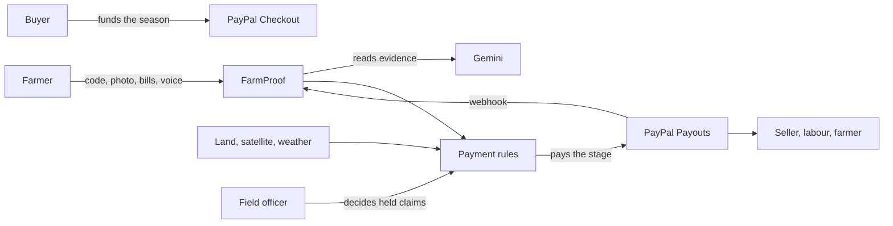
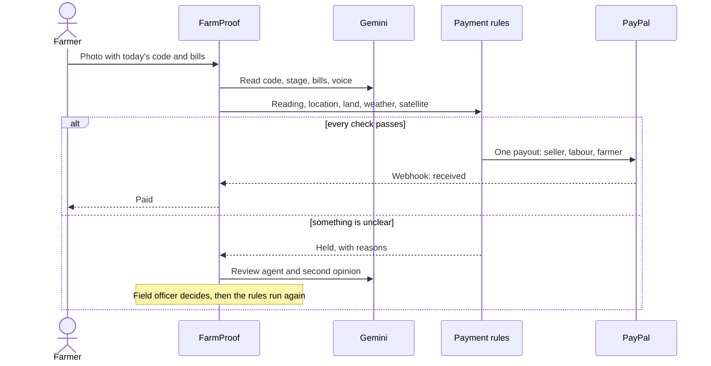

# FarmProof

[](https://developer.paypal.com/)
[](https://deepmind.google/models/gemini/)
[](https://github.com/vaibhavdes/FreshPay/actions/workflows/ci.yml)
[](LICENSE)

**Pay farmers the moment field work is proven.**

A buyer funds a crop season once with PayPal. Each time a farmer proves a stage of work (fertiliser bought, crop sprayed, harvest picked), FarmProof checks the proof and PayPal pays that stage at once: the input seller, the labour group and the farmer, each their share, in one payout. AI reads the evidence; fixed rules decide every payment.

PayPal AI Hackathon 2026 · **Live:** [farmproof-2y11.onrender.com](https://farmproof-2y11.onrender.com) · start at the [guided tour](https://farmproof-2y11.onrender.com/tour)

## The problem

A smallholder pays for every stage of a crop months before earning anything: seed, fertiliser, sprays, pickers. The buyer pays only after the crop is delivered and graded. The gap is filled with debt:

- **Half of India's farming households are in debt**: 50.2%, owing ₹74,121 on average, with nearly a third of loans from moneylenders and other informal lenders [1].
- **Smallholders worldwide face a financing gap of over US$200 billion a year** [2].
- **Buyers must already prove where crops come from.** From 30 December 2026, large and medium EU importers of coffee, cocoa, rubber and other crops must show, plot by plot, that nothing was grown on land deforested after 2020 [3].

Buyers would pay earlier if they could see their money turning into farm work. Today they can't:

- **A photo alone proves little.** India's rural jobs scheme moved to geotagged photo attendance, yet attendance was still marked with irrelevant photos of fields or trees [4].
- **Money meant for inputs doesn't reach the input seller.** An advance to the farmer can't show the fertiliser was bought.
- **Trust across borders is hard.** A roaster in Italy can't check a farm in Karnataka, and the farmer can't wait months for payment.

## What it does

1. **A company posts a season**: crop, price, expected yield, how much it pays ahead, and what each stage pays.
2. **Farmers join** with **Log in with PayPal** and mark their farm on a map. A land check confirms no forest was cleared there since 2020.
3. **The company funds the season** once with **PayPal Checkout**.
4. **The farmer proves a stage**: today's code written on paper, photographed on the farm with the bills for the work, and an optional voice note in any language.
5. **AI reads the evidence**: the code, the crop stage, every bill (amount, seller, number, date) and the voice note, translated.
6. **The rules check it** (the Proof Score below).
7. **PayPal pays the stage**: each bill straight to whoever issued it, plus the farmer's share, in one **PayPal Payouts** batch, confirmed by **PayPal webhooks**.
8. **Anything doubtful waits for a person.** An AI review agent investigates and recommends, a second AI pass looks for reasons not to pay, and the field officer decides.
9. **The season closes.** At delivery the buyer **authorizes** the balance, **captures** only what passes quality and **voids** the rest; the shipment is **tracked** and farmers are paid. A verified weather disaster **refunds** the unearned fund instead.
10. **Anyone can check it**: the season fund shown as a wallet with every payment in motion, each farm's satellite timeline, every check behind every payment, and a tamper-evident payment record.

Four crops run on the same engine: coffee in Karnataka, potato in Gujarat and cotton in Madhya Pradesh (India), and cocoa in San Martín (Peru). Each has its own stages, local suppliers and published yield and price. Testers without a farm can pick a ready photo of any stage, with today's code and bills added for the outcome they want to see; farmers take or upload their own.

## Hackathon brief coverage

| Brief | FarmProof |
|---|---|
| Meaningful use of PayPal | Checkout, Payouts, Log in with PayPal, authorize / capture / void, tracking, refunds, webhooks, disputes, Transaction Search, subscriptions and Vault, each with a job in the season |
| Meaningful use of AI | AI reads photos, bills and voice notes; a review agent investigates held claims; a second pass challenges approvals; a Season Agent answers the buyer using PayPal's Agent Toolkit; an agent drafts dispute evidence |
| A working prototype | The whole season runs on the PayPal sandbox: fund, prove, check, pay, confirm, settle |
| "Pays contractors automatically when a job is marked complete" | Farm work is the job; the checked proof is the completion |
| "A payout tool that pays out the moment a task is approved" | Each proven stage pays the seller, the labour group and the farmer at once |
| Social impact | Farmers are paid when their costs fall due, without borrowing against a crop that is already sold |

## Proof Score

**Hard checks** decide. **Signals** back them up; any signal that contradicts the claim holds it for a person.

| Check | Kind | Passes when | Otherwise |
|---|---|---|---|
| Today's code | Hard | The code in the photo is the one issued to this farm, within 15 minutes, used once | Refused |
| On the farm | Hard | The phone is inside the farm boundary | Refused |
| Right stage, right time | Hard | The stage is next in order and its window is open | Refused |
| Land check | Hard | No forest cleared on the farm since 2020 | Refused |
| Fund covers it | Hard | The season fund holds enough | Refused |
| Fresh evidence | Hard | The photo is not a copy of an earlier one, and no bill is paid twice | Held / refused |
| Bill matches | Hard | The bill is from the supplier being paid, dated within the stage | Held |
| AI reading | Hard | The AI is at least 80% sure it is a genuine, current photo of this stage | Held |
| Camera | Signal | Where and when the camera says the photo was taken | Held if far away or old |
| Phone location | Signal | The phone located itself precisely | Held if too rough |
| Weather | Signal | No downpour on a day of spraying or fertilising | Held |
| Satellite | Signal | Green canopy or crop growth, and no sudden clearing | Held |

## PayPal

| PayPal | Its job |
|---|---|
| **Checkout** | The buyer funds the season |
| **Payouts** | Each proven stage pays the input seller, the labour group, machinery hire and the farmer in one batch |
| **Log in with PayPal** | Farmers join with their own PayPal account, which receives their payments |
| **Authorize, capture, void** | At delivery, the buyer pays only for the weight and grade accepted |
| **Order tracking** | The shipment is attached to the payment |
| **Refunds** | A verified weather disaster returns the unearned fund |
| **Webhooks** | Confirm that every payout reached the person |
| **Disputes** | Buyer disputes are answered with an AI-drafted evidence pack, after a person approves |
| **Transaction Search** | The books are checked against PayPal every day |
| **Balances** | The wallet shows what the paying account holds, against the next stage payment |
| **Agent Toolkit** | The Season Agent's read-only PayPal lookups |
| **Subscriptions** | The buyer's workspace plan |
| **Vault** | A good-practice bonus charged within a limit the buyer approved |

A payment is never sent twice, even when a request is retried, and any PayPal failure is shown with PayPal's own reason.

## AI

| Component | Model | Job | Decides money? |
|---|---|---|---|
| Evidence reader | Gemini 3.5 Flash-Lite and 3.8 Flash | Reads the code, crop stage, bills and voice note | No |
| Review agent | Gemini 3.8 Flash | Investigates held claims and recommends, with reasons | No: a person decides |
| Second opinion | Gemini 3.8 Flash | Challenges every "approve"; any doubt makes it "not sure" | No |
| Season Agent | Gemini in AG Studio, with PayPal's Agent Toolkit | Answers the buyer's questions with charts, looks up transactions, orders, tracking and disputes in PayPal, and proposes actions | No: toolkit access is read-only and actions go through the rules |
| Dispute agent | Gemini | Drafts the evidence for a buyer dispute | No: a person sends it |

## How it works





## Run it

**Needs:** Node 22+ and a PayPal sandbox app with Payouts, Transaction Search and Log in with PayPal turned on.

```bash
npm install
cp .env.template .env.local   # add PAYPAL_CLIENT_ID, PAYPAL_SECRET and CHALLENGE_SECRET
npm run season
npm run dev                  # http://localhost:3000
```

Optional keys in `.env.template` turn on AI, land checks and satellite views. Without AI, claims wait for the field officer. `npm test` runs the 231 tests.

## Credits

**Built with** [PayPal](https://developer.paypal.com/) and its [Agent Toolkit](https://github.com/paypal/agent-toolkit) · [Gemini](https://deepmind.google/models/gemini/) · [Next.js](https://nextjs.org/) · [AG Studio and AG Grid](https://www.ag-grid.com/) · [APIMatic](https://www.apimatic.io/) · [Render](https://render.com/) · [MapLibre](https://maplibre.org/)

**Data:** farm outlines © [OpenStreetMap](https://www.openstreetmap.org/copyright) contributors (ODbL) · tree cover loss: [Global Forest Watch](https://www.globalforestwatch.org/), UMD (CC BY 4.0) · contains modified Copernicus Sentinel data 2025–2026 ([Copernicus Data Space Ecosystem](https://dataspace.copernicus.eu/)) · weather: [Open-Meteo](https://open-meteo.com/) (CC BY 4.0) · imagery: Esri World Imagery · farm photos: Wikimedia Commons contributors, CC BY and CC BY-SA ([full credits](https://farmproof-2y11.onrender.com/credits)) · yields and prices: [Coffee Board of India](https://coffeeboard.gov.in/Database/DATABASE3_JULY2023.pdf), Karnataka market reports, Gujarat agriculture department, Committee on Cotton Production and Consumption, Government of India MSP 2026-27, Gobierno Regional de San Martín · exchange rate: FBIL

## Sources

1. National Statistical Office, *Situation Assessment of Agricultural Households, 2019* (NSS 77th round), Report 587: [mospi.gov.in](https://www.mospi.gov.in/sites/default/files/publication_reports/Report_587m_0.pdf)
2. ISF Advisors, *Beyond the Frontier*, October 2025: [isfadvisors.co](https://isfadvisors.co/global-report-smallholder-finance/)
3. Regulation (EU) 2023/1115, as amended by Regulation (EU) 2025/2650: [EUR-Lex](https://eur-lex.europa.eu/eli/reg/2023/1115/oj)
4. The Wire, *NMMS didn't end corruption in MGNREGA*: [thewire.in](https://thewire.in/labour/nmms-didnt-end-corruption-in-mgnrega-it-changed-its-shape-and-locked-workers-out)

## License

[MIT](LICENSE)
