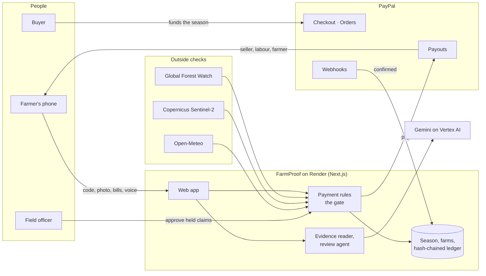

# FarmProof

[](https://developer.paypal.com/)
[](https://cloud.google.com/vertex-ai)
[](https://github.com/vaibhavdes/FreshPay/actions/workflows/ci.yml)
[](LICENSE)

**Pay farmers the moment field work is proven.**

A buyer anywhere funds a crop season once with PayPal. Each time a farmer proves a stage of work (fertiliser bought, crop sprayed, harvest picked), FarmProof checks the proof with AI, GPS, satellites and fraud checks, and PayPal Payouts pays that stage straight away: the input seller, the labour group and the farmer, each their share, in one batch. The AI reads the evidence; plain code decides every payment.

PayPal AI Hackathon 2026 · *Build what's next with PayPal and AI*

**Live:** [farmproof-2y11.onrender.com](https://farmproof-2y11.onrender.com) (Render). Start at the [guided tour](https://farmproof-2y11.onrender.com/tour).

## The problem

A smallholder pays for every stage of a crop long before it earns anything. Seed, fertiliser, sprays and pickers are paid for months before the harvest, while the buyer pays only after the crop is delivered and graded. The gap is filled with debt:

- **Half of India's farming households are in debt.** The National Statistical Office found 50.2% of agricultural households indebted, owing ₹74,121 on average, and nearly a third of their loans come from non-institutional lenders such as moneylenders [1].
- **The financing gap is worldwide.** Smallholder farmers need far more credit than lenders supply, a gap of over US$200 billion a year [2].
- **Buyers already have to look closely at the farm.** From 30 December 2026, large and medium EU importers of coffee, cocoa, rubber and other crops must prove, plot by plot, that what they buy was not grown on land deforested after 2020 [3].

Buyers would pay earlier if they could see their money turning into farm work. Today they can't:

- **A photo alone proves little.** India's rural jobs scheme moved to geotagged photo attendance to curb corruption, yet attendance could still be marked with irrelevant photos of fields or trees, without meaningful verification [4].
- **Money meant for inputs doesn't reach the input seller.** An advance paid to the farmer can't show that the fertiliser was bought.
- **Cross-border trust is hard.** A roaster in Germany cannot verify a farm in Karnataka, and the farmer cannot wait for a letter of credit.

## What it does

1. **A company posts a season.** It picks a crop (coffee, potato, cocoa, organic cotton), sets the price, the yield and how much it pays ahead. Each stage has its own window and caps for each kind of bill.
2. **Farmers join.** They sign in with **Log in with PayPal** and walk or paste their farm boundary. A satellite land check runs straight away: Global Forest Watch tree cover loss since 2020.
3. **The company funds the season once** with **PayPal Checkout**. The money is held as a season fund for these farms.
4. **The farmer proves a stage.** The app issues a one-time code. The farmer writes it on paper and photographs it on the farm with the bills for the work, adding a voice note in any language if they like.
5. **AI reads the evidence.** Gemini reads the handwritten code, the crop stage, every bill (amount, kind, seller, bill number, date) and translates the voice note.
6. **Code checks it.** The code, the farm boundary, the stage window, the land check, the fund balance, reuse of photos and bills, the bill seller and date, and outside signals from the camera, weather and Sentinel-2 satellite (see the Proof Score below).
7. **PayPal pays the stage.** Each bill is paid what it says, up to its cap, straight to whoever issued it, plus the farmer's share: one **PayPal Payouts** batch. A signed **PayPal webhook** confirms when the money arrives.
8. **Anything doubtful waits for a person.** The review agent investigates and recommends, a second AI pass looks for reasons not to pay, and the field officer approves or refuses. The money rules run again before anything moves.
9. **The season ends.** The balance is **authorized**, then **partially captured** for the weight and grade accepted, the rest **voided** and the shipment **tracked**; farmers are paid their share. A weather-verified disaster **refunds** the unearned fund to the buyer instead.
10. **Everyone can check it.** Each farm shows its satellite timeline, every check behind every payment, how fast the money moved and a downloadable farm record. Every payment is written to a hash-chained record that anyone can verify on a public page.

## Hackathon brief coverage

| Brief | FarmProof |
|---|---|
| Meaningfully use PayPal | Checkout, Payouts, Log in with PayPal, authorize / capture / void, tracking, refunds, webhooks, disputes, Transaction Search, subscriptions and Vault, each with a real job in the season |
| Meaningfully use AI | Gemini reads photos, bills and voice notes; a tool-using review agent investigates held claims; a second AI pass challenges approvals; a Season Agent answers the buyer's questions; an agent drafts dispute evidence |
| A working prototype | The full season runs live on the PayPal sandbox: fund, prove, check, pay, confirm by webhook, settle |
| Inspiration: "pays contractors automatically when a job is marked complete" | Farm work is the job; the proof is the completion; PayPal Payouts pays the moment it is checked |
| Inspiration: "a payout tool … that pays out the moment a task is approved" | Each stage pays the input seller, the labour group and the farmer in one batch |
| Social impact: financial inclusion | Farmers are paid as costs fall due, not months later, without borrowing against a crop that is already sold |

## Proof Score

Every claim gets a score with reasons, shown to the farmer, the officer and the buyer. **Hard checks** decide; **signals** back them up, and any signal that contradicts the claim holds it for a person.

| Check | Kind | Passes when | Otherwise |
|---|---|---|---|
| Today's code | Hard | The handwritten code matches the one issued to this farm, within 15 minutes, used once | Refused |
| On the farm | Hard | The phone is inside the farm boundary (100 m margin) | Refused |
| Right stage, right time | Hard | The stage is next in order and its window is open | Refused |
| Land check | Hard | No forest cleared on the farm since 2020 | Refused |
| Fund covers it | Hard | The season fund holds enough | Refused |
| Fresh evidence | Hard | The photo is not a near-copy of an earlier one (perceptual hash), and no bill is paid twice | Held / refused |
| Bill matches | Hard | The seller on the bill is the supplier being paid, dated within the stage | Held |
| AI reading | Hard | Gemini is at least 80% sure it is a genuine, current field photo of this stage | Held |
| Camera | Signal | Where and when the camera says the photo was taken | Held if far away or old |
| Phone accuracy | Signal | The phone located itself to within 100 m | Held if too rough |
| Weather | Signal | No downpour on a day of spraying or fertilising | Held |
| Satellite | Signal | Sentinel-2 shows green canopy (tree crops) or crop growth (field crops), and no sudden clearing | Held |

A held claim goes to the field officer with the review agent's recommendation and every reason.

## PayPal

| PayPal capability | Its job in FarmProof |
|---|---|
| **Orders v2 + JS SDK v6** | The buyer funds the season fund with PayPal Checkout |
| **Payouts** | Each proven stage pays the input seller, the labour group, machinery hire and the farmer in one batch |
| **Log in with PayPal** | Farmers join with their own verified PayPal account, which then receives their payments |
| **Authorize → partial capture → void, reauthorize** | At delivery, the buyer pays only for the weight and grade accepted |
| **Order tracking** | The shipment is attached to the captured order |
| **Refunds** | A weather-verified disaster returns the unearned fund to the buyer |
| **Webhooks + signature verification** | Confirms every payout and records whether the API or the webhook arrived first |
| **Disputes** | Syncs buyer disputes and sends an AI-drafted evidence pack after a person approves |
| **Transaction Search** | Reconciles the books against PayPal every day |
| **Subscriptions** | The buyer's workspace plan, the business model |
| **Vault** | A good-practice bonus charged within a buyer's saved-PayPal mandate, or through a buyer-approved order where saving PayPal isn't enabled |

Every payment call carries a `PayPal-Request-Id`, so a retry never pays twice. Failures show PayPal's own issue code and `debug_id`, and a fault panel on the tour triggers PayPal's sandbox failures on purpose. The integration uses the PayPal Server SDK, built with the **APIMatic PayPal context plugin**.

## AI

| Component | Model | Job | Decides money? |
|---|---|---|---|
| Evidence reader | Gemini 3.5 Flash-Lite, then 3.8 Flash, on Vertex AI | Reads the photo and voice note: code, crop stage, bills, weight slip, transcript and English translation | No |
| Review agent | Gemini 3.8 Flash with read-only tools | Investigates held claims (evidence, farm history, reused photos, land check, a second look) and recommends with reasons | No: a person approves |
| Second opinion | Gemini 3.8 Flash | Challenges every "approve" recommendation; any doubt turns it into "not sure" | No |
| Season Agent | AG Studio Agent Framework + Gemini + read-only PayPal tools | Answers the buyer's questions with filters and charts, and proposes actions | No: proposals go through the rules |
| Dispute agent | Gemini | Drafts the evidence narrative for a buyer dispute | No: a person sends it |

Gemini runs on Vertex AI through a token bridge on Google Cloud Run, so no Google key exists anywhere.

## How it works



One proof, from the farmer's phone to the money:

```mermaid
sequenceDiagram
    actor Farmer
    participant App as FarmProof
    participant AI as Gemini
    participant Gate as Payment rules
    participant PayPal
    Farmer->>App: Get today's code
    Farmer->>App: Photo with code and bills, GPS, voice note
    App->>AI: Read code, stage, bills, voice
    App->>Gate: Reading + GPS + land, weather, satellite, reuse checks
    alt every check passes
        Gate->>PayPal: Payouts batch (seller, labour, farmer)
        PayPal-->>App: Signed webhook: received
        App-->>Farmer: Paid
    else something is unclear
        Gate-->>App: Held, with reasons
        App->>AI: Review agent investigates, second opinion
        Note over App: Field officer approves or refuses; the rules run again
    end
```

## Run it

**Needs:** Node 22+ and a PayPal sandbox REST app on a business account with Payouts, Transaction Search and Log in with PayPal turned on.

```bash
npm install
cp .env.example .env.local   # PAYPAL_CLIENT_ID, PAYPAL_SECRET and a 32+ character CHALLENGE_SECRET
npm run seed
npm run dev                  # http://localhost:3000
```

Optional keys in `.env.example` turn on Gemini (Vertex AI or the Gemini API), Global Forest Watch land checks and Copernicus satellite views. Without Gemini, claims are held for the field officer.

**Try it:** Guided tour → Start my own season → fund it with PayPal → open the farmer's phone → get the code, take the photo, send → see the payment on the farm record → open the officer's queue → season end.

```bash
npm test                # 224 tests, including a real year of Sentinel-2 data replayed month by month
npm run doctor          # checks PayPal, the database, the land checks and Gemini
npm run evidence        # prints real PayPal sandbox IDs for every API used
```

**Deploy:** `render.yaml` deploys the web service with a persistent disk and two daily jobs (reconciliation, authorization renewal). Render deploys only after GitHub Actions passes typecheck, lint, tests and a production build.

## Credits

**Built with** [PayPal](https://developer.paypal.com/) · [Gemini on Vertex AI](https://cloud.google.com/vertex-ai) · [Next.js](https://nextjs.org/) · [Vercel AI SDK](https://ai-sdk.dev/) · [AG Studio and AG Grid](https://www.ag-grid.com/) · [APIMatic](https://www.apimatic.io/) · [Render](https://render.com/) · [Drizzle](https://orm.drizzle.team/) · [MapLibre](https://maplibre.org/) · [sharp](https://sharp.pixelplumbing.com/) · [Vitest](https://vitest.dev/).

**Data:** farm outlines © [OpenStreetMap](https://www.openstreetmap.org/copyright) contributors (ODbL) · tree cover loss: [Global Forest Watch](https://www.globalforestwatch.org/), UMD (CC BY 4.0) · contains modified Copernicus Sentinel data 2025–2026, via the [Copernicus Data Space Ecosystem](https://dataspace.copernicus.eu/) · weather: [Open-Meteo](https://open-meteo.com/) (CC BY 4.0) · imagery: Esri World Imagery · yields and prices: [Coffee Board of India](https://coffeeboard.gov.in/) and Karnataka market reports · exchange rate: FBIL reference rate.

## Sources

1. National Statistical Office, *Situation Assessment of Agricultural Households and Land and Livestock Holdings of Households in Rural India, 2019* (NSS 77th round), Report 587: [mospi.gov.in](https://www.mospi.gov.in/sites/default/files/publication_reports/Report_587m_0.pdf)
2. ISF Advisors, *Beyond the Frontier: global report on smallholder finance*, October 2025: [isfadvisors.co](https://isfadvisors.co/global-report-smallholder-finance/)
3. Regulation (EU) 2023/1115 on deforestation-free products, as amended by Regulation (EU) 2025/2650: [EUR-Lex](https://eur-lex.europa.eu/eli/reg/2023/1115/oj)
4. The Wire, *NMMS didn't end corruption in MGNREGA. It changed its shape and locked workers out*: [thewire.in](https://thewire.in/labour/nmms-didnt-end-corruption-in-mgnrega-it-changed-its-shape-and-locked-workers-out)

## License

[MIT](LICENSE)
